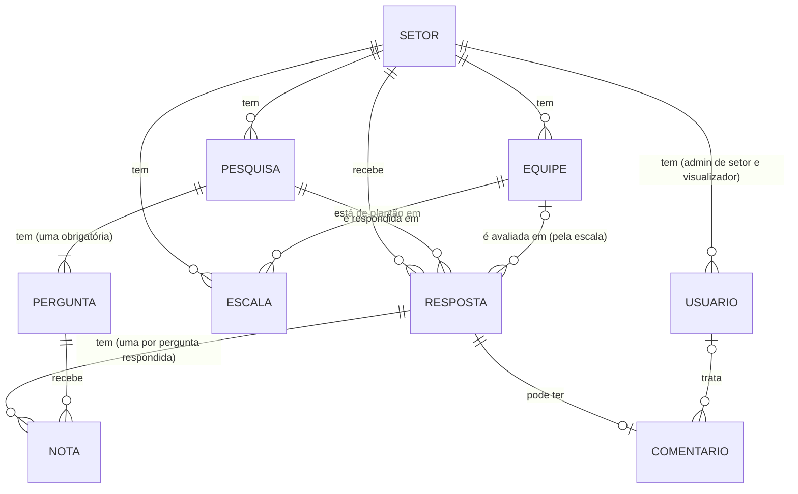
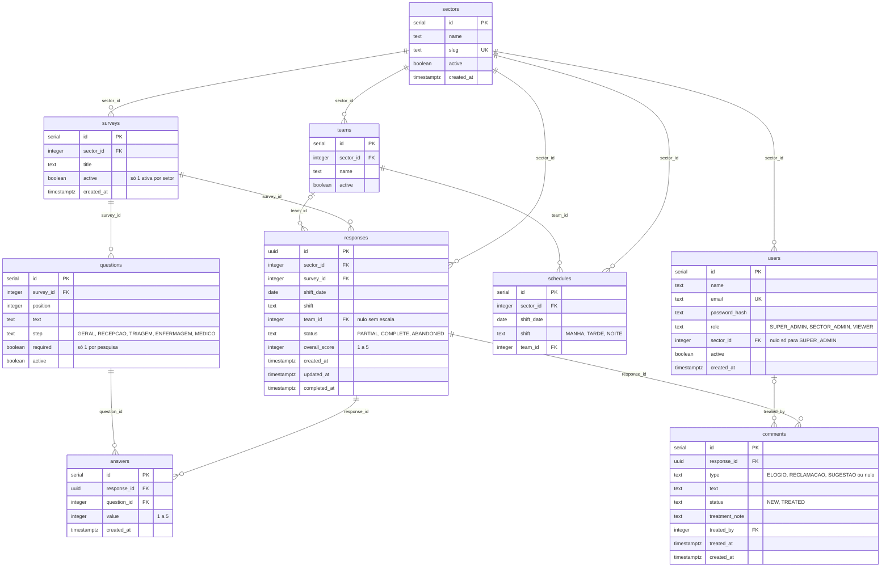
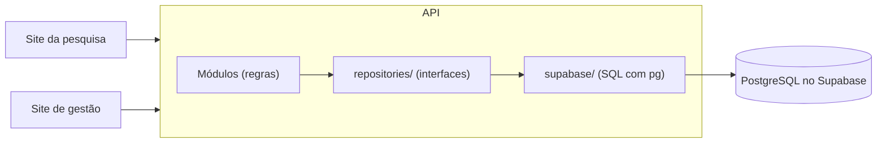

# Relatório do banco de dados

Relatório da disciplina de Banco de Dados (tarefa B7). Ele explica a escolha do tipo de banco, mostra os modelos conceitual e lógico, os scripts de criação e povoamento, e como o projeto garante integridade, desempenho e facilidade de trocar de banco.

O contrato completo das tabelas está no README (seção 8). Os scripts estão em [`database/`](../database/).

## Sumário

1. [Resumo da escolha](#1-resumo-da-escolha)
2. [Relacional (SQL) ou não relacional (NoSQL)?](#2-relacional-sql-ou-não-relacional-nosql)
3. [Por que o Supabase](#3-por-que-o-supabase)
4. [Modelo conceitual](#4-modelo-conceitual)
5. [Modelo lógico](#5-modelo-lógico)
6. [Integridade dos dados](#6-integridade-dos-dados)
7. [Índices e desempenho](#7-índices-e-desempenho)
8. [Scripts de criação e povoamento](#8-scripts-de-criação-e-povoamento)
9. [Como o banco pode ser trocado](#9-como-o-banco-pode-ser-trocado)
10. [Privacidade (LGPD)](#10-privacidade-lgpd)

---

## 1. Resumo da escolha

| Pergunta | Escolha |
| --- | --- |
| Tipo de banco | **Relacional (SQL)**, com PostgreSQL |
| Onde roda | **Supabase** (PostgreSQL gerenciado), um banco só para as duas aplicações |
| Como a aplicação acessa | Só pela API, com **SQL puro** pela biblioteca `pg` |
| Como as tabelas são criadas | Arquivos `.sql` versionados no git (`database/migrations/`), rodados com `npm run db:migrate` |
| Como os dados de exemplo entram | Arquivos `.sql` em `database/seeds/`, rodados com `npm run db:seed` |
| Validação no código | Um schema Zod por tabela em `packages/schemas/`, com os mesmos campos e regras do SQL |

## 2. Relacional (SQL) ou não relacional (NoSQL)?

### O que os dados do sistema têm

1. **Muitas ligações entre os dados.** Uma resposta pertence a um setor e a uma pesquisa; tem várias notas (uma por pergunta) e pode ter um comentário; e é ligada a uma equipe pela escala (setor + data do plantão + turno).
2. **Regras que não podem ser quebradas.** Só uma pesquisa ativa por setor (RN02); só uma pergunta obrigatória por pesquisa (RN05); carinha só de 1 a 5 (RN04); uma equipe por setor, dia e turno (RN14).
3. **Indicadores calculados a partir de muitas linhas.** O dashboard faz médias e contagens agrupadas por setor, turno, equipe, etapa e dia (RN20 a RN22).
4. **Operações que precisam ser "tudo ou nada".** Criar uma pesquisa já com a pergunta obrigatória; ativar uma pesquisa desativando a anterior; salvar a escala e atualizar as respostas do mesmo dia e turno.

### Comparação

| Necessidade do sistema | Relacional (PostgreSQL) | Não relacional de documentos (ex.: MongoDB) |
| --- | --- | --- |
| Ligar resposta → equipe pela escala | Um `JOIN` entre `responses` e `schedules` pelo setor, data e turno | Exige consultas em duas coleções ou copiar a equipe dentro de cada resposta |
| Regras como "só uma pesquisa ativa por setor" | O próprio banco garante, com índice único parcial | A garantia fica no código da aplicação |
| Chaves estrangeiras (não existir nota de pergunta que não existe) | `REFERENCES`, verificado pelo banco | Não existe; a aplicação precisa conferir |
| Médias e contagens por setor, turno, equipe e dia | `AVG`, `COUNT`, `GROUP BY`, `FILTER` em uma consulta | Possível com *aggregation pipeline*, mas mais longo e com `$lookup` entre coleções |
| Operações "tudo ou nada" em várias tabelas | Transações (`BEGIN`/`COMMIT`/`ROLLBACK`) | Existem, mas não são o uso principal |
| Guardar uma resposta com as notas juntas | Duas tabelas (`responses` e `answers`) | Um documento só, com as notas dentro: aqui o NoSQL seria natural |

### Conclusão

O único ponto em que o NoSQL ajudaria é guardar cada resposta como um documento só. Em todo o resto (ligação com a escala, regras garantidas pelo banco, indicadores e operações "tudo ou nada"), o modelo relacional resolve com menos código e mais segurança. Por isso a escolha foi o **relacional (SQL)**.

Exemplos reais do projeto que dependem disso:
- o dashboard calcula a média geral e a quantidade de cada carinha numa consulta só, com `COUNT(*) FILTER (WHERE overall_score = 1)` (`apps/api/src/database/supabase/dashboard.repository.ts`);
- salvar a escala grava os plantões e atualiza a equipe das respostas na mesma transação (`apps/api/src/database/supabase/schedules.repository.ts`).

## 3. Por que o Supabase

Decisão da dupla:
- é um **PostgreSQL** completo e gerenciado, com plano gratuito, sem precisar instalar nada nos computadores;
- **um banco só** atende as duas aplicações (pesquisa e gestão) e as duas pessoas da dupla durante o desenvolvimento.

O projeto usa do Supabase **apenas o banco PostgreSQL**. Não usa o login do Supabase (Supabase Auth) nem a biblioteca própria dele (`supabase-js`). O login é feito pela API, com tabela própria de usuários, e todo o acesso é SQL padrão pela biblioteca `pg`. Isso é o que permite trocar de banco (seção 9).

## 4. Modelo conceitual

Entidades do sistema e como se relacionam (cardinalidades):



Leitura em palavras:
- Um **setor** tem várias **pesquisas** (só uma ativa), várias **equipes**, vários **usuários** e a sua **escala**.
- Uma **pesquisa** tem várias **perguntas**, sempre com exatamente uma obrigatória.
- A **escala** diz qual equipe estava de plantão em cada setor, data e turno.
- Uma **resposta** do paciente é de um setor e de uma pesquisa, e fica ligada a no máximo uma equipe (a da escala daquele dia e turno).
- Uma resposta tem uma **nota** (carinha de 1 a 5) por pergunta respondida e pode ter um **comentário** anônimo.
- Um **usuário** da gestão pode tratar vários comentários.
- **O paciente não é uma entidade**: a pesquisa é 100% anônima (RN08).

## 5. Modelo lógico

Tabelas, colunas, tipos e chaves, como estão nas migrations (`database/migrations/`).



Escolhas do modelo lógico:

| Escolha | Por quê |
| --- | --- |
| `responses.id` é **UUID** (as outras tabelas usam número sequencial) | O id da resposta fica no celular do paciente durante a pesquisa. Um UUID não dá para adivinhar, então ninguém consegue mexer na resposta de outra pessoa trocando o número |
| `responses.overall_score` repete a nota da pergunta obrigatória | O dashboard usa muito a nota geral (RN20); com ela na própria resposta, não precisa juntar com `answers` e `questions` toda vez |
| `responses.team_id` é guardado, e não calculado a cada consulta | Os indicadores por equipe ficam simples e rápidos. Quando a escala muda, a API atualiza as respostas daquele dia e turno na mesma transação (decisão D4) |
| `shift_date` é do tipo `DATE`, separado de `created_at` | A madrugada pertence ao plantão da noite anterior (RN13), então a data do plantão nem sempre é o dia do relógio |
| Tipos fixos como texto com `CHECK` (e não `ENUM` do PostgreSQL) | `CHECK` é SQL padrão e mais fácil de levar para outro banco; acrescentar um valor novo é só uma migration |
| Nada é apagado: setores, usuários, perguntas e equipes têm `active` | O histórico de respostas continua íntegro; "apagar" na tela significa desativar |

## 6. Integridade dos dados

O próprio banco recusa dados errados, mesmo que a aplicação tenha um erro:

| Regra | Como o banco garante | Regra do README |
| --- | --- | --- |
| Carinha só de 1 a 5 | `CHECK (value BETWEEN 1 AND 5)` em `answers` e em `overall_score` | RN04 |
| Só os perfis, etapas, turnos e situações previstos | `CHECK (... IN (...))` em cada coluna desses tipos | RN06, RN13, RN16, RN17 |
| Super admin sem setor; os outros perfis com setor | `CHECK` `users_sector_by_role` | RN16 |
| Só uma pesquisa ativa por setor | Índice único parcial `surveys_one_active_per_sector` (`WHERE active`) | RN02 |
| Só uma pergunta obrigatória por pesquisa | Índice único parcial `questions_one_required_per_survey` (`WHERE required`) | RN05 |
| Uma equipe por setor, dia e turno | `UNIQUE (sector_id, shift_date, shift)` em `schedules` | RN14 |
| Uma nota por pergunta em cada resposta | `UNIQUE (response_id, question_id)` em `answers` (permite "trocar" a nota) | RN09 |
| Link do setor sem repetição | `UNIQUE` em `sectors.slug` | RN01 |
| E-mail sem repetição | `UNIQUE` em `users.email` | RN16 |
| Nada aponta para o que não existe | `REFERENCES` (chave estrangeira) em todas as ligações | — |
| Operações "tudo ou nada" | Transações na API: criar pesquisa + obrigatória; ativar pesquisa; salvar escala + atualizar respostas; cada migration inteira | RN02, RN05, RN14 |

Essas regras foram testadas: antes de rodar no Supabase, a migration foi executada num PostgreSQL em memória (PGlite), e cada regra acima foi conferida com dados certos (aceitos) e errados (recusados). Os testes automáticos da API fazem o mesmo a cada execução.

## 7. Índices e desempenho

### Índices que existem hoje

| Índice | Tabela | Para que serve |
| --- | --- | --- |
| Chave primária | Todas | Buscar uma linha pelo `id` |
| `UNIQUE` de `slug` | `sectors` | Abrir a pesquisa pelo link do QR Code (`/public/sectors/:slug`) |
| `UNIQUE` de `email` | `users` | Login |
| `surveys_one_active_per_sector` | `surveys` | Achar a pesquisa ativa do setor (e garantir que é só uma) |
| `UNIQUE (sector_id, shift_date, shift)` | `schedules` | Achar a equipe de plantão ao criar uma resposta (RN14) e ler a escala do mês |
| `UNIQUE (response_id, question_id)` | `answers` | Juntar as notas de uma resposta e gravar cada toque (RN09) |
| `responses_sector_created_at` (`sector_id, created_at`) | `responses` | Respostas de um setor por ordem de chegada |
| `responses_sector_shift` (`sector_id, shift_date, shift`) | `responses` | Dashboard e escala: respostas de um setor por data do plantão e turno (migration 003) |
| `comments_status` | `comments` | Filtrar os comentários novos ou tratados |

Todas as consultas usam parâmetros (`$1`, `$2`...), nunca valores colados no texto do SQL. Isso protege contra injeção de SQL e deixa o PostgreSQL reaproveitar o plano da consulta.

### Melhoria aplicada: índice por setor + data do plantão + turno

**O problema:** o dashboard e a escala procuram as respostas por **setor + data do plantão + turno** (`shift_date`, `shift`), e não pela data em que a resposta chegou (`created_at`):
- o dashboard filtra por período, setor, turno e equipe usando `shift_date` (`dashboard.repository.ts`);
- salvar a escala atualiza as respostas `WHERE sector_id = ... AND shift_date = ... AND shift = ...` (`schedules.repository.ts`).

O índice da migration 001, `responses(sector_id, created_at)`, só ajudava a separar o setor: o banco ainda lia todas as respostas daquele setor e descartava as de outras datas e turnos.

**A solução:** a migration `003_indice_respostas_plantao.sql` cria o índice `responses_sector_shift` em `responses (sector_id, shift_date, shift)`, na mesma ordem em que essas buscas filtram. Ela só acrescenta o índice; nenhum dado muda.

**A medição:** num PostgreSQL em memória (PGlite) com **60.000 respostas** (4 setores, 270 dias, 3 turnos), a mesma busca do dashboard ("média do setor 1, turno da noite, em setembro") e a mesma atualização da escala ("respostas do setor 1, noite de 10/09"), medidas com `EXPLAIN ANALYZE` antes e depois do índice:

| | Antes (só o índice da 001) | Depois (com o índice da 003) |
| --- | --- | --- |
| Índice escolhido pelo PostgreSQL | `responses_sector_created_at` | `responses_sector_shift` |
| Linhas lidas e descartadas pelo filtro | 14.556 | 0 |
| Blocos lidos da tabela | 741 | 222 |
| Tempo da busca do dashboard | 3,4 a 5,8 ms | 0,8 a 0,9 ms |
| Tempo da atualização da escala | 2,9 a 6,5 ms | 0,04 ms |
| Resultado | 444 respostas, média 3,0 | o mesmo |

Os tempos variam a cada execução e são de um banco em memória; o que importa é a diferença: com o índice novo, o banco vai direto às respostas certas, sem ler e descartar milhares de linhas. Com os poucos dados de hoje a diferença não aparece; ela passa a importar quando o hospital acumular meses de respostas.

Um teste automático (`apps/api/tests/migrations.test.ts`) roda todas as migrations e confere que essa busca usa o índice novo.

## 8. Scripts de criação e povoamento

### Criação (DDL): `database/migrations/`

| Arquivo | O que faz |
| --- | --- |
| `001_cria_tabelas.sql` | Cria as 9 tabelas, com chaves, `CHECK`, `UNIQUE` e índices |
| `002_equipes_ativas.sql` | Acrescenta `teams.active`, para equipes serem desativadas em vez de apagadas (tarefa B14) |
| `003_indice_respostas_plantao.sql` | Cria o índice `responses_sector_shift` para o dashboard e a escala (seção 7) |
| `004_remove_codigo_setor.sql` | Apaga `sectors.code`: o código curto do setor saiu, e cada setor ficou com um link só, `/avaliacao/<slug>` (RN01) |

Como rodar (na raiz do projeto, com o `DATABASE_URL` no `apps/api/.env`):

```bash
npm run db:migrate
```

O comando roda os arquivos em ordem, cada um numa transação ("tudo ou nada"), e anota os que já rodaram na tabela de controle `schema_migrations`. Rodar de novo só aplica os arquivos novos. Uma migration que já rodou nunca é editada: mudanças entram num arquivo novo.

### Povoamento (DML): `database/seeds/`

Dados de exemplo feitos pela Estefanie (tarefa A9), para testar e apresentar o sistema:

| Arquivo | O que insere |
| --- | --- |
| `001_setores_e_pesquisas.sql` | 4 setores, uma pesquisa ativa por setor e as perguntas de cada uma |
| `002_equipes_e_escala.sql` | Três equipes por setor e a escala do mês atual e dos 30 dias anteriores |
| `003_usuarios.sql` | Um usuário de exemplo de cada perfil |
| `004_respostas_e_comentarios.sql` | 160 respostas dos últimos 20 dias, com as notas e comentários variados |

Como rodar:

```bash
npm run db:seed
```

Os arquivos rodam em ordem, todos numa transação só. A senha dos usuários de exemplo vem do `SEED_PASSWORD` do `.env` e é gravada com bcrypt; ela nunca fica escrita nos arquivos. O comando só roda com o banco vazio, para nunca duplicar dados.

## 9. Como o banco pode ser trocado

Requisito do cliente: o banco precisa ser fácil de substituir no futuro (RNF01). O projeto foi organizado em camadas para isso:



1. Os dois sites nunca falam com o banco, só com a API.
2. As regras da API (módulos) só conhecem as **interfaces** de `apps/api/src/database/repositories/`, que dizem *o que* dá para fazer, sem dizer *qual* banco é.
3. Só a pasta `apps/api/src/database/supabase/` tem SQL. O único arquivo que escolhe qual implementação usar é `apps/api/src/database/index.ts`.
4. O SQL das migrations e das consultas é PostgreSQL padrão, sem recursos exclusivos do Supabase, e o login não usa o Supabase Auth.

**Para trocar por outro PostgreSQL** (outro serviço ou um servidor do próprio hospital): basta mudar o `DATABASE_URL` e rodar `npm run db:migrate` no banco novo.

**Para trocar por outro tipo de banco:** cria-se uma pasta ao lado de `supabase/` com as mesmas operações das interfaces e muda-se só o `database/index.ts`. Os módulos, os sites e os testes das regras continuam iguais.

Uma prova de que isso funciona: os testes automáticos já usam outro banco, um PostgreSQL em memória (PGlite), no lugar do Supabase, sem mudar nenhuma regra.

## 10. Privacidade (LGPD)

- **Paciente:** nenhuma tabela guarda dado pessoal (sem nome, telefone, e-mail ou CPF). A resposta guarda só setor, data, hora, turno, notas e o comentário que a própria pessoa escreveu (RN08, D3).
- **Usuários da gestão:** o banco guarda nome e e-mail de quem usa o site de gestão. A senha nunca é guardada; só o resultado embaralhado pelo bcrypt (`password_hash`), que não dá para desfazer.
- **Acesso:** só a API conecta no banco. O endereço com a senha do banco (`DATABASE_URL`) fica no `.env`, que nunca vai para o git.
